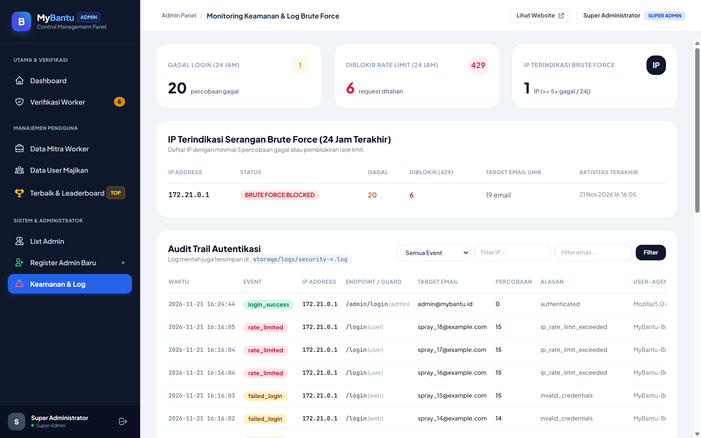
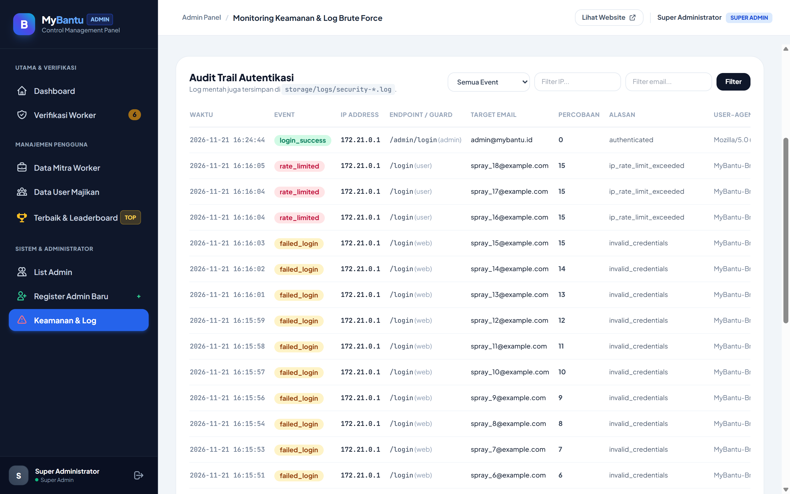
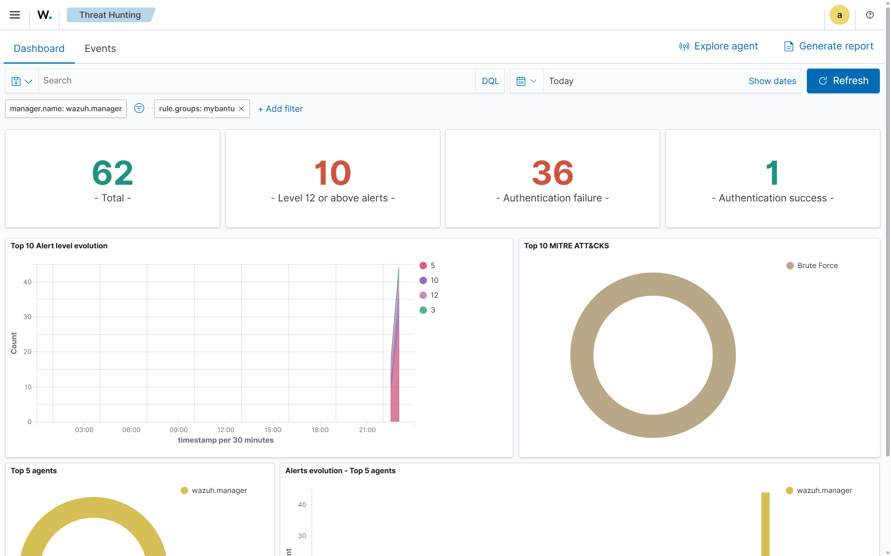
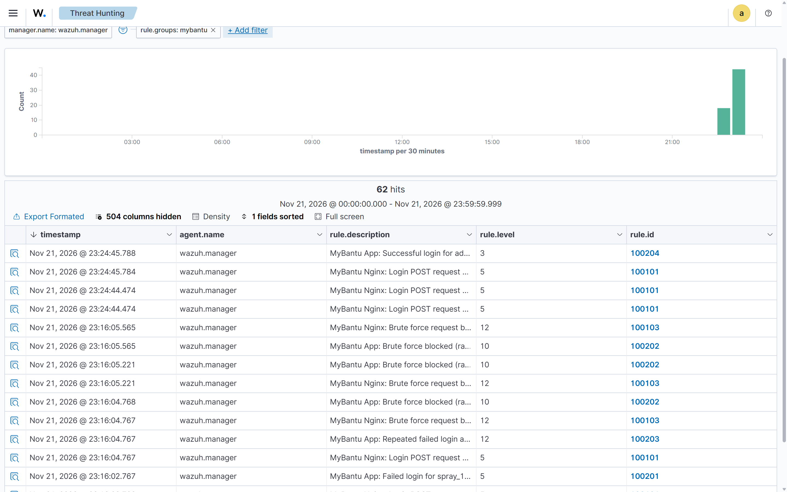
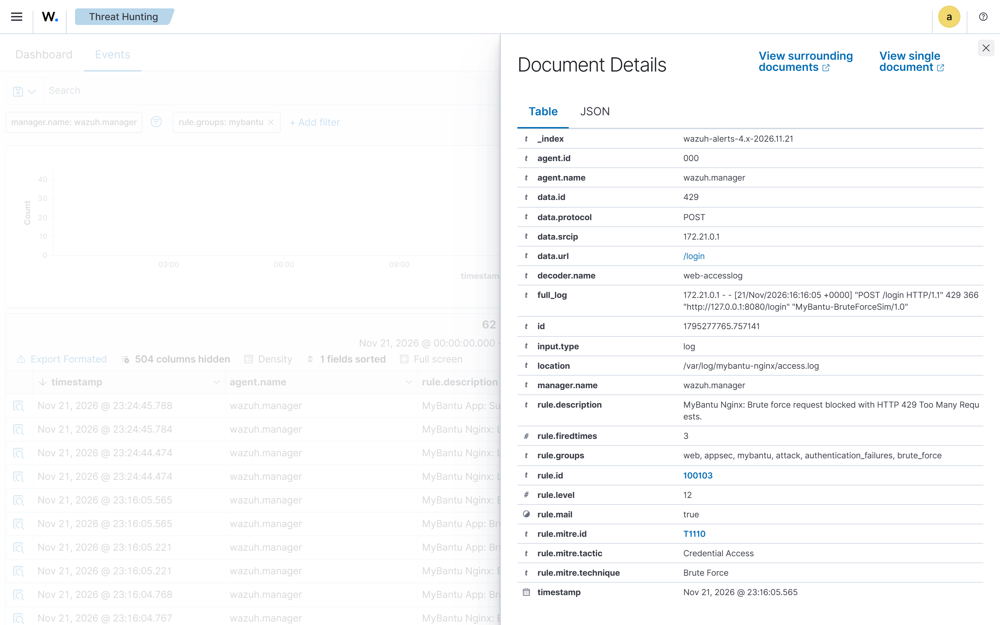
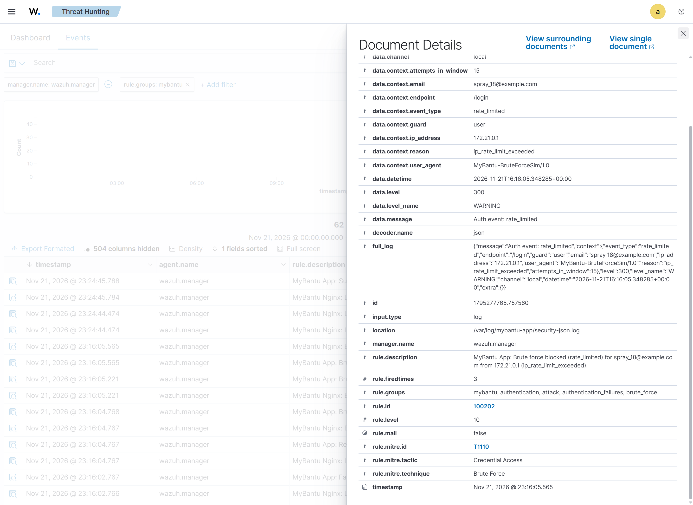

# LAPORAN IMPLEMENTASI & ANALISIS MONITORING SERANGAN BRUTE FORCE
## Dual-Layer Security Monitoring: Server-Side (Nginx + Wazuh SIEM) dan Admin-Side (Aplikasi Laravel MyBantu)

- **Aplikasi:** MyBantu (Laravel 13, PHP 8.3, MySQL)
- **Tanggal Pengujian:** 21 November 2026
- **Arsitektur Monitoring:**
  - **Sisi Server (Infrastructure / SIEM):** Docker Compose — Nginx Reverse Proxy (`:8080` → `:8000`) + Wazuh Single-Node `v4.9.2` (Wazuh Manager, Wazuh Indexer, Wazuh Dashboard `:5601`)
  - **Sisi Aplikasi (Admin-Side):** `BruteForceMonitor` (`RateLimiter`), tabel database `security_logs`, dedicated log channel (`security` & `security_json`), serta Panel Monitoring Admin (`/admin/security-logs`)
- **Standar Referensi:** MITRE ATT&CK `T1110` (*Brute Force — Credential Access*) & OWASP A07 (*Identification and Authentication Failures*)

---

## 1. Pendahuluan & Arsitektur Monitoring Dual-Layer

Serangan *brute force* terhadap halaman login (baik akun pengguna biasa maupun administrator) merupakan salah satu ancaman keamanan web yang paling umum. Apabila monitoring hanya dilakukan di level web server (Nginx `access.log`), administrator tidak dapat melihat konteks aplikasi seperti alamat email yang ditargetkan atau alasan kegagalan autentikasi. Sebaliknya, apabila monitoring hanya dilakukan di level aplikasi, serangan di luar endpoint aplikasi atau pencatatan terpusat (SIEM) tidak tersedia.

Oleh karena itu, pada aplikasi **MyBantu** diterapkan arsitektur **Dual-Layer Security Monitoring** yang menggabungkan:
1. **Lapisan Aplikasi (Admin-Side MyBantu):** Mencegah serangan secara aktif menggunakan `RateLimiter` (`HTTP 429`) dan merekam konteks autentikasi (`email`, `guard`, `endpoint`, `ip_address`, `user_agent`, `reason`, `attempts_in_window`) ke database `security_logs` serta file log terpisah (`storage/logs/security-*.log` dan `storage/logs/security-json.log`).
2. **Lapisan Server / SIEM (Nginx + Wazuh):** Seluruh trafik HTTP masuk melalui **Nginx Reverse Proxy** (`http://127.0.0.1:8080`) yang mencatat `access.log` & `error.log`. **Wazuh Manager** membaca log Nginx maupun `security-json.log` milik Laravel secara *real-time*, mencocokkannya dengan *Custom Rule ID* (`100101`–`100204`), memetakan ke **MITRE ATT&CK `T1110`**, lalu menyimpannya ke **Wazuh Indexer (OpenSearch)** untuk divisualisasikan di **Wazuh Dashboard** (`https://127.0.0.1:5601`).

```text
[Penyerang / simulate_bruteforce.py]
            │  HTTP POST /login atau /admin/login (Port 8080)
            ▼
┌──────────────────────────────────────────┐
│  Nginx Reverse Proxy Container (:8080)   │───► docker/wazuh/logs/nginx/access.log & error.log
└───────────────────┬──────────────────────┘                     │
                    │ proxy_pass host.docker.internal:8000       │
                    ▼                                            │ (read-only mount)
┌──────────────────────────────────────────┐                     │
│  Laravel MyBantu (:8000)                 │                     ▼
│  - BruteForceMonitor (RateLimiter 429)   │        ┌─────────────────────────────┐
│  - DB: security_logs (Panel Admin)       │        │  Wazuh Manager (:1514)      │
│  - File: storage/logs/security-json.log  │───────►│  - ossec.conf (<localfile>) │
└──────────────────────────────────────────┘        │  - local_rules.xml (T1110)  │
                                                    └──────────────┬──────────────┘
                                                                   │ Filebeat
                                                                   ▼
                                                    ┌─────────────────────────────┐
                                                    │  Wazuh Indexer (:9200)      │
                                                    │  Wazuh Dashboard (:5601)    │
                                                    └─────────────────────────────┘
```

---

## 2. Konfigurasi Awal (Setup) Sebelum Monitoring & Simulasi

### 2.1 Konfigurasi Awal di Sisi Aplikasi Laravel (Admin-Side)

| Komponen / File | Tujuan & Konfigurasi Utama |
| :--- | :--- |
| `bootstrap/app.php` | Mengaktifkan `$middleware->trustProxies(at: '*')` agar `$request->ip()` membaca IP klien yang diteruskan Nginx (`X-Forwarded-For` / `X-Real-IP`). |
| `config/logging.php` | Menambahkan channel `security` (`daily` → `storage/logs/security-YYYY-MM-DD.log`) dan channel `security_json` (`Monolog\Formatter\JsonFormatter` → `storage/logs/security-json.log`) agar mudah di-*parse* oleh Wazuh. |
| `database/migrations/2026_11_18_000001_create_security_logs_table.php` | Membuat tabel `security_logs` dengan kolom `event_type`, `endpoint`, `guard`, `email`, `ip_address`, `user_agent`, `reason`, `attempts_in_window`, dan `created_at`. |
| `app/Services/BruteForceMonitor.php` | Mengatur batas **5 percobaan gagal / 60 detik** per kombinasi `email + IP` (*Single-Target*) dan **15 percobaan gagal / 60 detik** per `IP` (*Password Spraying*). Jika batas terlampaui, mengembalikan **HTTP `429`** dan menulis event `rate_limited`. |
| `AuthController.php` & `AdminAuthController.php` | Memanggil `ensureIsNotRateLimited()`, `recordFailedAttempt()`, dan `recordSuccess()` pada endpoint `POST /login` dan `POST /admin/login`. |
| `AdminSecurityLogController.php` & `admin/security-logs/index.blade.php` | Menyediakan halaman monitoring admin pada route `/admin/security-logs` (menu sidebar **Keamanan & Log**). |

### 2.2 Konfigurasi Awal di Sisi Server (Docker: Nginx + Wazuh Single-Node)

#### Langkah 1: Konfigurasi Nginx Reverse Proxy (`docker/wazuh/config/nginx/default.conf`)
Nginx berjalan pada port `8080` dan meneruskan request ke server Laravel lokal (`host.docker.internal:8000`) sambil menulis log akses berformat `combined`:

```nginx
server {
    listen 80;
    server_name localhost;

    access_log /var/log/nginx/access.log combined;
    error_log  /var/log/nginx/error.log warn;

    location / {
        proxy_pass http://host.docker.internal:8000;
        proxy_http_version 1.1;
        proxy_set_header Host              $http_host;
        proxy_set_header X-Real-IP         $remote_addr;
        proxy_set_header X-Forwarded-For   $proxy_add_x_forwarded_for;
        proxy_set_header X-Forwarded-Proto $scheme;
        proxy_redirect off;
    }
}
```

#### Langkah 2: Konfigurasi `docker-compose.yml` & Penyesuaian Memori
Pada `docker/wazuh/docker-compose.yml`, dilakukan penyesuaian penting agar stabil di lingkungan Docker Desktop lokal:
- **Heap Wazuh Indexer:** `OPENSEARCH_JAVA_OPTS=-Xms768m -Xmx768m -XX:MaxDirectMemorySize=384m` (mencegah error *OutOfMemoryError direct buffer memory* pada `OpenSearchSecurityPlugin`).
- **Port Dashboard:** Dipetakan ke `5601:5601` (`https://127.0.0.1:5601`) agar tidak bentrok dengan port `443` host Windows.
- **Volume Log & Rules pada `wazuh.manager`:**
  - `./config/wazuh_cluster/wazuh_manager.conf:/wazuh-config-mount/etc/ossec.conf`
  - `./config/wazuh_cluster/local_rules.xml:/wazuh-config-mount/etc/rules/local_rules.xml`
  - `./logs/nginx:/var/log/mybantu-nginx:ro`
  - `../../storage/logs:/var/log/mybantu-app:ro`

#### Langkah 3: Generate Sertifikat TLS & Menjalankan Stack Docker
```powershell
cd docker\wazuh
docker compose -f generate-indexer-certs.yml run --rm generator
docker compose up -d
docker compose ps
```

#### Langkah 4: Konfigurasi Pengambilan Log pada Wazuh Manager (`wazuh_manager.conf` / `ossec.conf`)
Agar `wazuh-logcollector` membaca log Nginx dan Laravel secara otomatis, ditambahkan blok `<localfile>` berikut (serta menonaktifkan `vulnerability-detection` untuk efisiensi RAM):

```xml
<!-- MyBantu Nginx Reverse Proxy Logs -->
<localfile>
  <log_format>apache</log_format>
  <location>/var/log/mybantu-nginx/access.log</location>
</localfile>

<localfile>
  <log_format>apache</log_format>
  <location>/var/log/mybantu-nginx/error.log</location>
</localfile>

<!-- MyBantu Laravel Structured Security JSON Log -->
<localfile>
  <log_format>json</log_format>
  <location>/var/log/mybantu-app/security-json.log</location>
</localfile>
```

#### Langkah 5: Pengaturan Custom Rule ID Wazuh (`local_rules.xml`)
Pada Wazuh, rentang **Rule ID `100000`–`120000`** dikhususkan untuk *custom rules* pengguna. Berikut daftar **7 Custom Rule ID** yang dikonfigurasi pada `docker/wazuh/config/wazuh_cluster/local_rules.xml`:

| Rule ID | Sumber Log | Level | Kondisi Pemicu (Trigger) | MITRE ATT&CK | Arti & Fungsi Deteksi |
| :--- | :--- | :---: | :--- | :---: | :--- |
| **`100101`** | Nginx (`access.log`) | **5** | `<if_group>web</if_group>` + `POST /login` atau `POST /admin/login` | — | Mencatat setiap percobaan request `POST` ke halaman login di level web server Nginx. |
| **`100102`** | Nginx (`access.log`) | **10** | `frequency="5"`, `timeframe="60"` dari rule `100101` dengan `<same_source_ip/>` | **`T1110`** | **Deteksi Brute Force di Nginx:** 5+ request `POST` login dalam 60 detik dari IP yang sama (setara konsep `rule id 31510` pada referensi tesis). |
| **`100103`** | Nginx (`access.log`) | **12** | `<if_group>web</if_group>` + HTTP Status `429` | **`T1110`** | **Critical Alert:** Request serangan berhasil diblokir dan Nginx mengembalikan `HTTP 429 Too Many Requests`. |
| **`100201`** | Laravel (`security-json.log`) | **5** | `<decoded_as>json</decoded_as>` + `context.event_type = failed_login` | — | Mencatat 1 kegagalan login di aplikasi lengkap dengan email target, guard, dan IP penyerang. |
| **`100202`** | Laravel (`security-json.log`) | **10** | `<decoded_as>json</decoded_as>` + `context.event_type = rate_limited` | **`T1110`** | **Active Block Alert:** Mencatat pemblokiran aktif oleh `BruteForceMonitor` beserta alasannya (`account_rate_limit_exceeded` atau `ip_rate_limit_exceeded`). |
| **`100203`** | Laravel (`security-json.log`) | **12** | `frequency="5"`, `timeframe="60"` dari rule `100201` dengan `<same_field>context.ip_address</same_field>` | **`T1110`** | **Korelasi Brute Force Aplikasi:** Mengonfirmasi 5+ kegagalan autentikasi beruntun dari IP yang sama dalam 1 menit. |
| **`100204`** | Laravel (`security-json.log`) | **3** | `<decoded_as>json</decoded_as>` + `context.event_type = login_success` | — | Audit trail login berhasil (misal saat Administrator masuk ke dashboard). |

---

## 3. Step-by-Step Eksekusi Simulasi Serangan Brute Force

Karena endpoint login Laravel dilindungi oleh mekanisme **CSRF Protection (`_token`)**, simulasi serangan dilakukan menggunakan skrip otomatis `scripts/simulate_bruteforce.py` yang:
1. Mengirim `GET /login` terlebih dahulu untuk memperoleh cookie session dan mengekstrak input `_token`.
2. Mengirim rentetan request `POST /login` dengan header `User-Agent: MyBantu-BruteForceSim/1.0` menuju **Nginx Reverse Proxy** (`http://127.0.0.1:8080`).

### 3.1 Skenario 1 — Single-Target Brute Force (1 Email Target, 8 Percobaan)
**Tujuan:** Menguji batas proteksi per akun (`5x gagal / 60 detik`).

**Perintah yang dijalankan:**
```powershell
python scripts/simulate_bruteforce.py --url http://127.0.0.1:8080 --mode single --email wazuh-test@example.com --count 8
```

**Hasil Eksekusi Terminal:**
```text
[*] Target: http://127.0.0.1:8080/login | Mode: single | Percobaan: 8
[01/08] email=wazuh-test@example.com -> HTTP 200
[02/08] email=wazuh-test@example.com -> HTTP 200
[03/08] email=wazuh-test@example.com -> HTTP 200
[04/08] email=wazuh-test@example.com -> HTTP 200
[05/08] email=wazuh-test@example.com -> HTTP 200
[06/08] email=wazuh-test@example.com -> BLOCKED (Rate Limited)
[07/08] email=wazuh-test@example.com -> BLOCKED (Rate Limited)
[08/08] email=wazuh-test@example.com -> BLOCKED (Rate Limited)
```
**Analisis Skenario 1:** Percobaan 1–5 gagal di tahap verifikasi kredensial (`302` → redirect `200` ke form login). Mulai percobaan ke-6 hingga ke-8, sistem langsung memblokir dengan **HTTP `429`** dan alasan `account_rate_limit_exceeded`.

### 3.2 Skenario 2 — Password Spraying (1 IP Menyerang 18 Email Berbeda)
**Tujuan:** Menguji deteksi serangan yang mengganti-ganti email untuk mengakali batas per akun, sehingga memicu batas per IP (`15x gagal / 60 detik`).

**Perintah yang dijalankan:**
```powershell
python scripts/simulate_bruteforce.py --url http://127.0.0.1:8080 --mode spray --count 18
```

**Hasil Eksekusi Terminal:**
```text
[*] Target: http://127.0.0.1:8080/login | Mode: spray | Percobaan: 18
[01/18] email=spray_1@example.com -> HTTP 200
...
[15/18] email=spray_15@example.com -> HTTP 200
[16/18] email=spray_16@example.com -> BLOCKED (Rate Limited)
[17/18] email=spray_17@example.com -> BLOCKED (Rate Limited)
[18/18] email=spray_18@example.com -> BLOCKED (Rate Limited)
```
**Analisis Skenario 2:** Meskipun email selalu berbeda, pada percobaan ke-16 hingga ke-18 **IP-level rate limiter** aktif memblokir seluruh request dengan **HTTP `429`** dan alasan `ip_rate_limit_exceeded`.

### 3.3 Bukti Raw Log yang Dihasilkan

**Cuplikan Raw Log Nginx (`docker/wazuh/logs/nginx/access.log`):**
```text
172.21.0.1 - - [21/Nov/2026:16:16:03 +0000] "POST /login HTTP/1.1" 302 366 "http://127.0.0.1:8080/login" "MyBantu-BruteForceSim/1.0"
172.21.0.1 - - [21/Nov/2026:16:16:04 +0000] "POST /login HTTP/1.1" 429 366 "http://127.0.0.1:8080/login" "MyBantu-BruteForceSim/1.0"
172.21.0.1 - - [21/Nov/2026:16:16:04 +0000] "POST /login HTTP/1.1" 429 366 "http://127.0.0.1:8080/login" "MyBantu-BruteForceSim/1.0"
172.21.0.1 - - [21/Nov/2026:16:16:05 +0000] "POST /login HTTP/1.1" 429 366 "http://127.0.0.1:8080/login" "MyBantu-BruteForceSim/1.0"
```

**Cuplikan Raw Log JSON Laravel (`storage/logs/security-json.log`):**
```json
{"message":"Auth event: failed_login","context":{"event_type":"failed_login","endpoint":"/login","guard":"web","email":"spray_15@example.com","ip_address":"172.21.0.1","user_agent":"MyBantu-BruteForceSim/1.0","reason":"invalid_credentials","attempts_in_window":15},"level":300,"level_name":"WARNING","channel":"local","datetime":"2026-11-21T16:16:03.849312+00:00","extra":{}}
{"message":"Auth event: rate_limited","context":{"event_type":"rate_limited","endpoint":"/login","guard":"user","email":"spray_18@example.com","ip_address":"172.21.0.1","user_agent":"MyBantu-BruteForceSim/1.0","reason":"ip_rate_limit_exceeded","attempts_in_window":15},"level":300,"level_name":"WARNING","channel":"local","datetime":"2026-11-21T16:16:05.348285+00:00","extra":{}}
```

---

## 4. Hasil Monitoring & Cara Membaca Log — Sisi Admin Aplikasi MyBantu

Untuk memantau dari sisi aplikasi, Administrator masuk ke `http://127.0.0.1:8080/admin/login` (`admin@mybantu.id`) dan membuka menu **Keamanan & Log** (`/admin/security-logs`).

### 4.1 Tampilan Ringkasan & IP Terindikasi Brute Force


*Gambar 1: Tampilan Kartu Ringkasan 24 Jam dan Tabel IP Terindikasi Serangan Brute Force pada `/admin/security-logs`.*

**Cara Membaca Gambar 1:**
1. **Kartu Gagal Login (24 Jam) — `20 percobaan gagal`:** Total gabungan percobaan gagal dari Skenario 1 (`5x`) + Skenario 2 (`15x`).
2. **Kartu Diblokir Rate Limit (24 Jam) — `6 request ditahan (429)`:** Total request yang ditahan sistem dari Skenario 1 (`3x`) + Skenario 2 (`3x`).
3. **Kartu IP Terindikasi Brute Force — `1 IP`:** Jumlah IP yang melewati ambang batas indikasi serangan (`>= 5` percobaan gagal dalam 24 jam).
4. **Tabel IP Terindikasi Serangan Brute Force:**
   - **IP Address `172.21.0.1`:** IP gateway Docker bridge asal request simulasi lokal (pada server publik akan tercatat IP publik penyerang).
   - **Status `BRUTE FORCE BLOCKED`:** Badge merah menandakan IP ini sudah memicu pemblokiran aktif `429` (bukan sekadar kesalahan ketik biasa).
   - **Target Email Unik `19 email`:** Bukti kuat terjadinya pola **Password Spraying** karena 1 IP menyerang 19 alamat email berbeda (`wazuh-test@example.com` + `spray_1` s.d. `spray_18`).

### 4.2 Tampilan Audit Trail Autentikasi (Kronologis)


*Gambar 2: Tabel Audit Trail Autentikasi yang menampilkan kronologi `failed_login`, `rate_limited`, dan `login_success` beserta kolom filter.*

**Cara Membaca Gambar 2:**
- **Filter Interaktif:** Admin dapat menyaring log berdasarkan `event_type` (`failed_login`, `rate_limited`, `inactive_account`, `login_success`), `IP Address`, atau `Email`.
- **Event Badge:**
  - `failed_login` (kuning): percobaan login gagal dengan alasan `invalid_credentials` (kolom **Percobaan** meningkat berurutan dari `1` hingga `15`).
  - `rate_limited` (merah): request diblokir otomatis dengan alasan `ip_rate_limit_exceeded` (untuk *spraying*) atau `account_rate_limit_exceeded` (untuk *single-target*).
  - `login_success` (hijau): login sah administrator (`admin@mybantu.id`) menggunakan browser Chrome.
- **Kolom User-Agent:** Memperlihatkan perbedaan jelas antara tool otomasi (`MyBantu-BruteForceSim/1.0`) dengan browser manusia normal (`Mozilla/5.0 ... Chrome/156.0.0.0`).

---

## 5. Hasil Monitoring & Cara Membaca Log — Sisi Server (Wazuh SIEM Dashboard)

Untuk memantau dari sisi server, buka **Wazuh Dashboard** di `https://127.0.0.1:5601` (login: `admin` / `SecretPassword`), masuk ke menu **Threat Hunting**, lalu tambahkan filter **`rule.groups: mybantu`** agar grafik dan tabel fokus pada seluruh alert Nginx & aplikasi MyBantu.

### 5.1 Wazuh Threat Hunting — Dashboard Overview


*Gambar 3: Tampilan Wazuh Threat Hunting Dashboard (`rule.groups: mybantu`) menampilkan 62 total alert, 10 alert Level 12+, 36 authentication failure, dan pemetaan MITRE ATT&CK Brute Force.*

**Cara Membaca Gambar 3:**
- **Total (`62`):** Gabungan alert yang dibangkitkan oleh Wazuh dari log Nginx dan log JSON Laravel selama simulasi.
- **Level 12 or above alerts (`10`):** Jumlah insiden berstatus kritis (terdiri dari blokir `HTTP 429` pada Nginx rule `100103` dan korelasi serangan beruntun rule `100203`).
- **Authentication failure (`36`):** Akumulasi seluruh event kegagalan dan pemblokiran autentikasi.
- **Authentication success (`1`):** Event login sukses admin (`100204`).
- **Top 10 MITRE ATT&CKS (`Brute Force`):** Wazuh secara otomatis mengklasifikasikan insiden ke dalam taktik *Credential Access* — teknik **`Brute Force (T1110)`**.

### 5.2 Wazuh Threat Hunting — Daftar Events & Timeline


*Gambar 4: Daftar Events kronologis di Wazuh Threat Hunting yang memperlihatkan korelasi langsung antara alert Nginx (`100101`, `100103`) dan Aplikasi (`100201`, `100202`, `100203`, `100204`).*

**Cara Membaca Gambar 4:**
- **Grafik Histogram Atas (`62 hits`):** Memperlihatkan dua puncak (*spike*) waktu serangan — puncak pertama saat Skenario 1 (*Single-Target*) dan puncak kedua saat Skenario 2 (*Password Spraying*).
- **Kolom `rule.level` & `rule.id`:** Membantu investigator memisahkan aktivitas biasa (Level `3`–`5`) dari serangan terkonfirmasi (Level `10`–`12`):
  - Setiap 1 request yang diblokir menghasilkan **sepasang alert berdekatan**: `100103` (Level 12 dari Nginx `access.log`) dan `100202` (Level 10 dari Laravel `security-json.log`).
  - Saat 5 kegagalan beruntun tercapai dalam 60 detik, muncul alert korelasi `100203` (Level 12) dan `100102` (Level 10).

### 5.3 Analisis Metadata Forensik di Wazuh — Layer Nginx (Rule ID `100103`)


*Gambar 5: Expanded Document Details pada alert Nginx `rule.id: 100103` (Level 12 — HTTP 429 Too Many Requests).*

**Tabel Penjelasan Metadata Log Nginx (`rule.id: 100103`):**

| Nama Metadata | Nilai pada Gambar 5 | Arti & Kegunaan Forensik |
| :--- | :--- | :--- |
| `data.srcip` | `172.21.0.1` | Alamat IP asal penyerang yang terekam oleh Nginx. |
| `data.protocol` | `POST` | Metode HTTP yang digunakan penyerang saat mengirim kredensial. |
| `data.url` | `/login` | Endpoint target serangan pada website MyBantu. |
| `data.id` | `429` | Kode respon HTTP dari server (`429 Too Many Requests` = diblokir rate limiter). |
| `decoder.name` | `web-accesslog` | Decoder bawaan Wazuh yang mem-parse format standar Nginx `access.log`. |
| `location` | `/var/log/mybantu-nginx/access.log` | Lokasi file log sumber di sisi server. |
| `rule.id` & `rule.level` | `100103` / `12` | Identitas custom rule kritis untuk blokir HTTP 429 pada Nginx. |
| `rule.mitre.id` / `technique` | `T1110` / `Brute Force` | Klasifikasi standar kerangka kerja MITRE ATT&CK (taktik *Credential Access*). |
| `full_log` | `172.21.0.1 - - [21/Nov/2026:16:16:05 +0000] "POST /login HTTP/1.1" 429 ... "MyBantu-BruteForceSim/1.0"` | Baris log mentah asli dari Nginx sebagai barang bukti forensik. |

### 5.4 Analisis Metadata Forensik di Wazuh — Layer Aplikasi Laravel (Rule ID `100202`)


*Gambar 6: Expanded Document Details pada alert Aplikasi MyBantu `rule.id: 100202` (Level 10 — `rate_limited` dengan konteks email dan alasan pemblokiran).*

**Tabel Penjelasan Metadata Log Aplikasi JSON (`rule.id: 100202`):**

| Nama Metadata | Nilai pada Gambar 6 | Arti & Kegunaan Forensik |
| :--- | :--- | :--- |
| `data.context.email` | `spray_18@example.com` | **Keunggulan integrasi JSON:** Memperlihatkan email target yang tidak bisa dibaca dari `access.log` Nginx standar. |
| `data.context.endpoint` & `guard` | `/login` / `user` | Endpoint dan guard autentikasi Laravel yang ditargetkan. |
| `data.context.event_type` | `rate_limited` | Jenis kejadian keamanan yang dicatat oleh `BruteForceMonitor`. |
| `data.context.reason` | `ip_rate_limit_exceeded` | Alasan spesifik pemblokiran (mengonfirmasi serangan *Password Spraying* per-IP). |
| `data.context.attempts_in_window` | `15` | Jumlah percobaan gagal yang tercatat dalam jendela waktu 60 detik. |
| `data.context.ip_address` | `172.21.0.1` | IP sumber serangan yang diteruskan melalui proxy terpercaya. |
| `data.context.user_agent` | `MyBantu-BruteForceSim/1.0` | Identitas klien/tool otomasi yang dipakai penyerang. |
| `decoder.name` | `json` | Decoder JSON native Wazuh yang otomatis memecah seluruh properti JSON menjadi field terindeks. |
| `location` | `/var/log/mybantu-app/security-json.log` | Lokasi file log JSON terstruktur milik Laravel MyBantu. |
| `rule.mitre.id` / `tactic` | `T1110` / `Credential Access` | Pemetaan otomatis ke teknik *Brute Force* pada MITRE ATT&CK. |

---

## 6. Perbandingan & Kesimpulan

| Dimensi Evaluasi | Sisi Admin Aplikasi MyBantu (`/admin/security-logs`) | Sisi Server — Wazuh SIEM (`https://127.0.0.1:5601`) |
| :--- | :--- | :--- |
| **Fokus Utama** | Pencegahan aktif (*Rate Limiter* 429) & pemantauan cepat oleh Admin bisnis. | Investigasi forensik terpusat (CLM/SIEM), korelasi multi-sumber, & visualisasi grafik. |
| **Sumber Data** | Tabel MySQL `security_logs` & `storage/logs/security-*.log`. | Log web server Nginx (`access.log`, `error.log`) + JSON Laravel (`security-json.log`). |
| **Kelebihan** | Ringan, langsung tahu `email`, `guard`, dan `reason`, serta langsung memblokir serangan. | Memiliki pemetaan MITRE ATT&CK (`T1110`), grafik evolusi level alert, penyimpanan terpisah (OpenSearch), dan siap diperluas untuk memantau SSH/`auditd` pada server Linux. |

### Kesimpulan
1. Implementasi **Dual-Layer Monitoring** pada aplikasi MyBantu berhasil mendeteksi sekaligus menahan serangan *Single-Target Brute Force* (terblokir pada percobaan ke-6) maupun *Password Spraying* (terblokir pada percobaan ke-16).
2. Integrasi log **Nginx (`access.log`)** dan **Laravel (`security-json.log`)** ke dalam **Wazuh v4.9.2** melalui 7 *Custom Rule ID* (`100101`–`100204`) berhasil mengatasi keterbatasan klasik log Nginx (tidak terlihatnya email/username target), sehingga seluruh bukti forensik dapat diaudit secara lengkap baik melalui Panel Admin MyBantu maupun Wazuh Dashboard.
