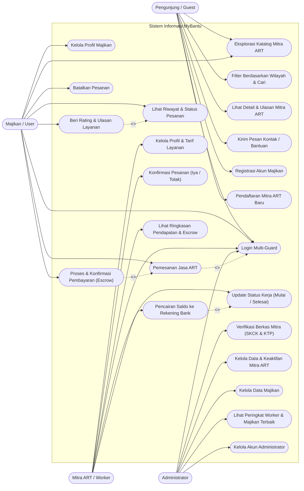
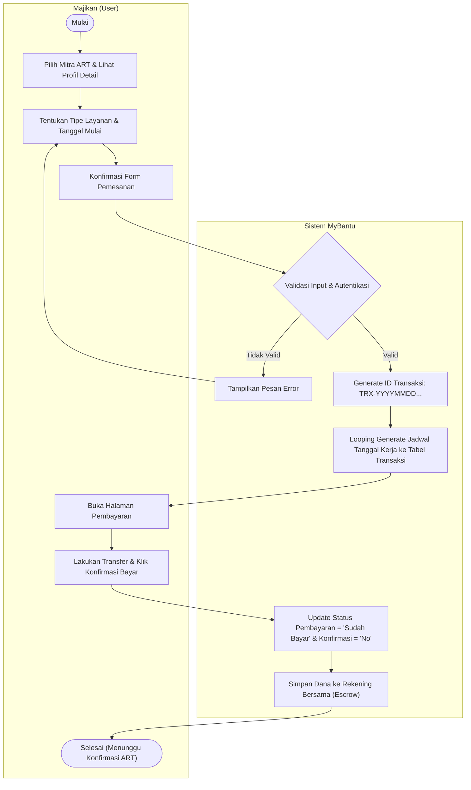
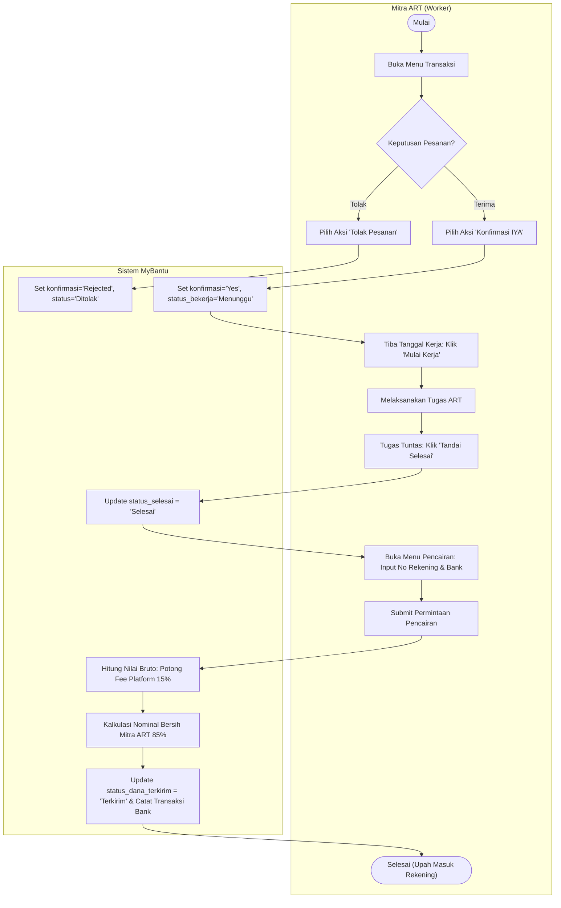
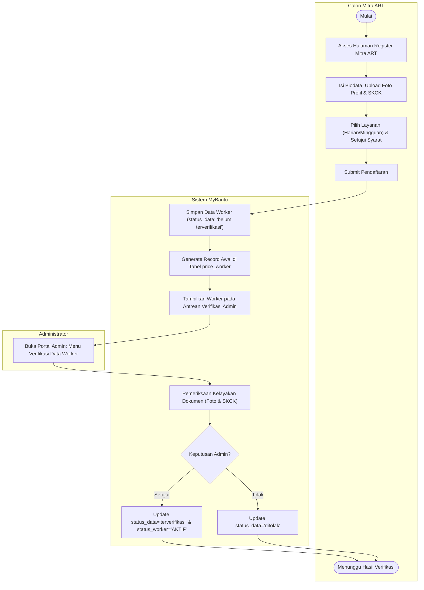

# DOKUMEN PERANCANGAN SISTEM INFORMASI (UML)
## Use Case Diagram, Activity Diagram, dan Sequence Diagram
**Platform Marketplace Layanan Asisten Rumah Tangga (MyBantu)**

---

- **Arsitektur:** Laravel 11 (PHP 8.3) MVC Multi-Guard (`web`, `worker`, `admin`)
- **Standar Pemodelan:** UML 2.5 (Unified Modeling Language)
- **Tahun Penyusunan:** 2026

---

## DAFTAR ISI
1. [BAB I. PENDAHULUAN & IDENTIFIKASI AKTOR SISTEM](#bab-i-pendahuluan--identifikasi-aktor-sistem)
2. [BAB II. USE CASE DIAGRAM & SPESIFIKASI](#bab-ii-use-case-diagram--spesifikasi)
3. [BAB III. ACTIVITY DIAGRAM (ALUR PROSES BISNIS)](#bab-iii-activity-diagram-alur-proses-bisnis)
4. [BAB IV. SEQUENCE DIAGRAM (INTERAKSI OBJEK MVC)](#bab-iv-sequence-diagram-interaksi-objek-mvc)
5. [BAB V. STATE MACHINE & MATRIKS STATUS DATA](#bab-v-state-machine--matriks-status-data)

---

## BAB I. PENDAHULUAN & IDENTIFIKASI AKTOR SISTEM

Sistem informasi MyBantu membagi hak akses ke dalam **4 (empat) aktor sistem** dengan autentikasi multi-guard:

| No | Aktor Sistem | Guard / Modul | Deskripsi Hak Akses & Peran Operasional |
| :--- | :--- | :--- | :--- |
| 1 | **Pengunjung (Guest)** | Publik (*Unauthenticated*) | Pengguna belum login. Dapat melihat beranda, katalog pekerja, filter wilayah provinsi/kabupaten, melihat profil publik & ulasan, halaman tentang kami, mengirim pesan kontak, dan registrasi. |
| 2 | **Majikan (User)** | `auth:web` | Majikan/pencari ART. Dapat mengelola profil, memesan mitra ART (harian/mingguan), memilih jadwal, konfirmasi pembayaran ke rekening bersama (*escrow*), membatalkan pesanan, dan memberi ulasan/rating. |
| 3 | **Mitra ART (Worker)** | `auth:worker` | Penyedia jasa ART. Dapat mengelola profil, foto, berkas SKCK, dan mengatur tarif harian/mingguan. Menerima pesanan, konfirmasi (Iya/Tolak), update progres kerja (Mulai/Selesai), mencairkan dana (payout), dan pantau upah. |
| 4 | **Administrator (Admin)** | `auth:admin` | Pengelola sistem MyBantu. Dapat memverifikasi berkas SKCK mitra, mengubah status keaktifan mitra (AKTIF/NONAKTIF), mengelola data majikan, melihat analitik performa *Best Worker* & *Best User*, memantau fee platform (15%), dan mengelola akun admin. |

> **Catatan Keuangan & Rekening Bersama (Escrow):**
> Pembayaran dari majikan ditampung sementara di rekening bersama MyBantu (`Sudah Bayar`). Setelah pekerjaan tuntas (`Selesai`), mitra ART mencairkan dana. Sistem otomatis memotong biaya fee platform **15%** dan menyalurkan upah bersih **85%** ke rekening bank mitra.

---

## BAB II. USE CASE DIAGRAM & SPESIFIKASI

### 2.1 Use Case Diagram (Mermaid)



### 2.2 Skenario Use Case Kunci

#### UC-08: Pemesanan Layanan ART (Booking Order)
- **Aktor:** Majikan (User)
- **Pre-condition:** Majikan login (`auth:web`) dan membuka detail mitra ART.
- **Main Flow:**
  1. Majikan memilih tipe pekerjaan (Harian/Mingguan), durasi/kuantitas, dan tanggal mulai.
  2. Majikan memverifikasi nomor handphone dan alamat lokasi pengerjaan.
  3. Majikan mengklik "Pesan Sekarang".
  4. Sistem memvalidasi input dan membuat ID Transaksi (`TRX-YYYYMMDD{workerId}{seq}`).
  5. Sistem menghitung total hari (Mingguan x7, Harian x1) dan melakukan looping insert jadwal ke tabel `transactions`.
  6. Sistem mengarahkan majikan ke halaman rincian tagihan pembayaran.
- **Post-condition:** Transaksi tersimpan dengan status `Belum Bayar`.

#### UC-09: Pembayaran Rekening Bersama (Escrow Payment)
- **Aktor:** Majikan (User)
- **Pre-condition:** Transaksi berstatus `Belum Bayar`.
- **Main Flow:**
  1. Majikan melihat rincian biaya (tarif satuan x kuantitas).
  2. Majikan melakukan transfer dan menekan "Saya Sudah Bayar".
  3. Sistem mengubah status menjadi `Sudah Bayar` dan `konfirmasi: No`.
  4. Transaksi masuk antrean menunggu konfirmasi mitra ART.

#### UC-15 & UC-16: Konfirmasi & Pelaksanaan Kerja
- **Aktor:** Mitra ART (Worker)
- **Main Flow:**
  1. Mitra ART membuka menu Transaksi di dashboard.
  2. Mitra memilih "Konfirmasi IYA" (status berubah `Menunggu`).
  3. Saat jadwal tiba, mitra memilih "Mulai Kerja" (status berubah `Proses`).
  4. Saat pekerjaan selesai, mitra memilih "Tandai Selesai" (status berubah `Selesai`).

#### UC-17: Pencairan Upah Mitra ART (Payout 85%)
- **Aktor:** Mitra ART (Worker)
- **Pre-condition:** Transaksi berstatus `Sudah Bayar` dan `Selesai`.
- **Main Flow:**
  1. Mitra membuka modal pencairan dana dan menginputkan bank tujuan, no rekening, dan nama rekening.
  2. Sistem menghitung total bruto (tarif satuan x kuantitas).
  3. Sistem memotong Fee Platform 15% (`fee_platform`).
  4. Sistem menghitung upah bersih 85% (`nominal_cair`).
  5. Sistem memperbarui status `status_dana_terkirim: Terkirim` dan mencatat waktu cair.

---

## BAB III. ACTIVITY DIAGRAM (ALUR PROSES BISNIS)

### 3.1 Activity Diagram 1: Pemesanan & Pembayaran Escrow (Majikan)



---

### 3.2 Activity Diagram 2: Konfirmasi, Pelaksanaan Kerja & Pencairan Upah (Mitra ART)



---

### 3.3 Activity Diagram 3: Pendaftaran & Verifikasi Mitra ART (Admin)



---

## BAB IV. SEQUENCE DIAGRAM (INTERAKSI OBJEK MVC)

### 4.1 Sequence Diagram 1: Pemesanan Layanan ART (`storeOrder`)

```mermaid
sequenceDiagram
    autonumber
    actor Majikan as Majikan (User)
    participant View as WorkerDetailView
    participant Ctrl as TransactionController
    participant WModel as Worker (Model)
    participant TModel as Transaction (Model)
    database DB as Database MySQL

    Majikan ->> View: Input (Qty, Tgl Mulai, Tipe Pekerjaan, Alamat, No HP)
    View ->> Ctrl: POST /order/{workerId} (Request Data)
    activate Ctrl

    Ctrl ->> Ctrl: Validasi data input & Autentikasi Guard 'web'
    Ctrl ->> WModel: findOrFail(workerId)
    WModel ->> DB: SELECT * FROM workers WHERE id = workerId
    DB -->> WModel: Data Worker Ditemukan
    WModel -->> Ctrl: Objek $worker

    Ctrl ->> Ctrl: Generate Format ID TRX (TRX-YYYYMMDD + workerId + seq)
    Ctrl ->> Ctrl: Hitung Total Hari (Mingguan x7, Harian x1)

    loop Sebanyak Total Hari Kerja
        Ctrl ->> TModel: create([id_transaksi, tanggal_kerja, konfirmasi: 'No', status_pembayaran: 'Belum Bayar', ...])
        TModel ->> DB: INSERT INTO transactions (...)
    end

    DB -->> TModel: Berhasil Disimpan
    TModel -->> Ctrl: Selesai Looping Insert

    Ctrl -->> View: Redirect ke route('transaksi.bayar.form', idTransaksi)
    deactivate Ctrl
    View -->> Majikan: Tampilkan Rincian Tagihan Pembayaran
```

---

### 4.2 Sequence Diagram 2: Konfirmasi Pembayaran Tagihan (`prosesBayar`)

```mermaid
sequenceDiagram
    autonumber
    actor Majikan as Majikan (User)
    participant View as BayarView
    participant Ctrl as TransactionController
    participant TModel as Transaction (Model)
    database DB as Database MySQL

    Majikan ->> View: Klik Tombol "Saya Sudah Bayar"
    View ->> Ctrl: POST /transaksi/bayar/{idTransaksi}
    activate Ctrl

    Ctrl ->> TModel: where('id_transaksi', idTransaksi)->where('user_id', Auth::id())
    Ctrl ->> TModel: update(['status_pembayaran' => 'Sudah Bayar', 'konfirmasi' => 'No'])
    TModel ->> DB: UPDATE transactions SET status_pembayaran='Sudah Bayar', konfirmasi='No' WHERE id_transaksi=...
    DB -->> TModel: Berhasil Diperbarui
    TModel -->> Ctrl: Sukses Update

    Ctrl -->> View: Redirect route('transaksi', ['status' => 'menunggu_konfirmasi'])
    deactivate Ctrl
    View -->> Majikan: Notifikasi Sukses "Menunggu Konfirmasi Mitra ART"
```

---

### 4.3 Sequence Diagram 3: Konfirmasi & Status Pengerjaan Mitra (`updateStatus`)

```mermaid
sequenceDiagram
    autonumber
    actor Worker as Mitra ART (Worker)
    participant View as WorkerDashboardView
    participant Ctrl as WorkerDashboardController
    participant TModel as Transaction (Model)
    database DB as Database MySQL

    Worker ->> View: Pilih Aksi ('konfirmasi_iya' / 'mulai_kerja' / 'selesai_kerja')
    View ->> Ctrl: POST /worker/transaksi/{idTransaksi}/status (action)
    activate Ctrl

    Ctrl ->> TModel: Validasi kepemilikan pesanan (worker_id == Auth::id())
    TModel ->> DB: SELECT COUNT(*) FROM transactions WHERE id_transaksi=... AND worker_id=...
    DB -->> TModel: Valid

    alt action == 'konfirmasi_iya'
        Ctrl ->> TModel: update(['konfirmasi' => 'Yes', 'status_bekerja' => 'Menunggu'])
        TModel ->> DB: UPDATE transactions SET konfirmasi='Yes', status_bekerja='Menunggu'
    else action == 'mulai_kerja'
        Ctrl ->> TModel: update(['status_bekerja' => 'Proses'])
        TModel ->> DB: UPDATE transactions SET status_bekerja='Proses'
    else action == 'selesai_kerja'
        Ctrl ->> TModel: update(['status_selesai' => 'Selesai'])
        TModel ->> DB: UPDATE transactions SET status_selesai='Selesai'
    end

    DB -->> TModel: Berhasil Diperbarui
    TModel -->> Ctrl: Sukses
    Ctrl -->> View: Redirect Back dengan Pesan Sukses
    deactivate Ctrl
    View -->> Worker: Tampilan Status Terkini
```

---

### 4.4 Sequence Diagram 4: Pencairan Dana & Fee Platform 15% (`cairkanDana`)

```mermaid
sequenceDiagram
    autonumber
    actor Worker as Mitra ART (Worker)
    participant View as CairkanDanaModal
    participant Ctrl as WorkerDashboardController
    participant PModel as PriceWorker (Model)
    participant TModel as Transaction (Model)
    database DB as Database MySQL

    Worker ->> View: Input (bank_tujuan, no_rekening, nama_rekening)
    View ->> Ctrl: POST /worker/transaksi/{idTransaksi}/cairkan
    activate Ctrl

    Ctrl ->> TModel: Validasi (status_pembayaran='Sudah Bayar', status_selesai='Selesai')
    TModel ->> DB: Query Transaksi
    DB -->> TModel: Data Valid ($firstTrx)

    Ctrl ->> PModel: Query Tarif Satuan Worker
    PModel ->> DB: SELECT harga FROM price_worker WHERE worker_id=... AND tipe_pekerjaan=...
    DB -->> PModel: Nilai Harga Satuan

    Ctrl ->> Ctrl: Hitung Bruto = (hargaSatuan * jumlah_qty)
    Ctrl ->> Ctrl: Hitung Fee Platform 15% = round(Bruto * 0.15)
    Ctrl ->> Ctrl: Hitung Bersih 85% = Bruto - Fee Platform

    Ctrl ->> TModel: update(['status_dana_terkirim' => 'Terkirim', 'fee_platform' => fee, 'nominal_cair' => net, ...])
    TModel ->> DB: UPDATE transactions SET status_dana_terkirim='Terkirim', fee_platform=..., nominal_cair=...
    DB -->> TModel: Berhasil Disimpan
    TModel -->> Ctrl: Sukses Payout

    Ctrl -->> View: Redirect Back dengan Rincian Transfer Sukses
    deactivate Ctrl
    View -->> Worker: Notifikasi Dana Bersih Diteruskan ke Rekening Bank
```

---

### 4.5 Sequence Diagram 5: Verifikasi Dokumen Mitra ART oleh Admin (`updateVerification`)

```mermaid
sequenceDiagram
    autonumber
    actor Admin as Administrator
    participant View as AdminVerifyIndexView
    participant Ctrl as AdminWorkerController
    participant WModel as Worker (Model)
    database DB as Database MySQL

    Admin ->> View: Klik Tombol "Verifikasi" / "Tolak" pada berkas SKCK & Foto
    View ->> Ctrl: POST /admin/workers/{id}/verify (status_data: 'terverifikasi'/'ditolak')
    activate Ctrl

    Ctrl ->> Ctrl: Validasi input (in: terverifikasi, belum terverifikasi, ditolak)
    Ctrl ->> WModel: findOrFail(id)
    WModel ->> DB: SELECT * FROM workers WHERE id = id
    DB -->> WModel: Data Worker Ditemukan

    Ctrl ->> WModel: update status_data = request->status_data
    WModel ->> DB: UPDATE workers SET status_data = 'terverifikasi' WHERE id = id
    DB -->> WModel: Sukses Diperbarui
    WModel -->> Ctrl: Objek Worker Updated

    Ctrl -->> View: Redirect Back dengan Flash Message Sukses
    deactivate Ctrl
    View -->> Admin: Status Mitra Berhasil Diverifikasi (Badge Hijau)
```

---

## BAB V. STATE MACHINE & MATRIKS STATUS DATA

### 5.1 Matriks Status Transaksi

| Tahapan Proses | status_pembayaran | konfirmasi | status_bekerja | status_selesai | status_dana_terkirim |
| :--- | :--- | :--- | :--- | :--- | :--- |
| **1. Pesanan Dibuat** | `Belum Bayar` | `No` | `NULL` | `NULL` | `Belum` |
| **2. Pembayaran Majikan (Escrow)** | `Sudah Bayar` | `No` | `NULL` | `NULL` | `Belum` |
| **3. Pesanan Ditolak Mitra** | `Sudah Bayar` | `Rejected` | `Ditolak` | `NULL` | `Belum` |
| **4. Diterima (Menunggu Jadwal)** | `Sudah Bayar` | `Yes` | `Menunggu` | `NULL` | `Belum` |
| **5. Sedang Dikerjakan** | `Sudah Bayar` | `Yes` | `Proses` | `NULL` | `Belum` |
| **6. Pekerjaan Selesai** | `Sudah Bayar` | `Yes` | `Proses` | `Selesai` | `Belum` |
| **7. Upah Dicairkan (Payout Selesai)** | `Sudah Bayar` | `Yes` | `Proses` | `Selesai` | `Terkirim` |

### 5.2 Matriks Status Mitra ART (Worker)

| Kolom | Nilai Status | Keterangan Operasional |
| :--- | :--- | :--- |
| `status_data` | `belum terverifikasi` | Mitra baru mendaftar, berkas SKCK dan foto menunggu verifikasi admin. |
| | `terverifikasi` | Berkas disetujui, mitra aktif menerima pesanan. |
| | `ditolak` | Berkas tidak valid / ditolak oleh admin. |
| `status_worker` | `AKTIF` | Akun aktif dan tampil di katalog produk & hasil pencarian. |
| | `NONAKTIF` | Akun dinonaktifkan sementara oleh admin. |

---
*Dokumen Perancangan Sistem MyBantu © 2026.*
